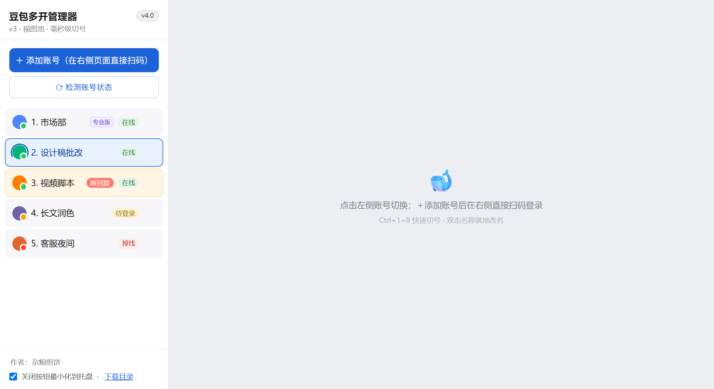
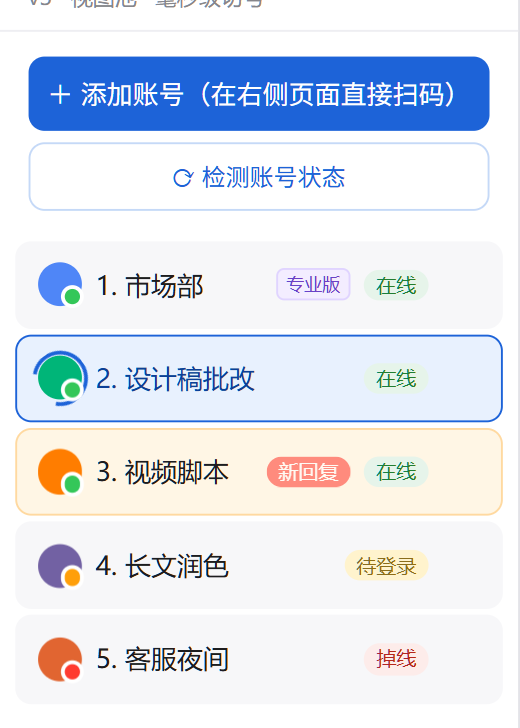
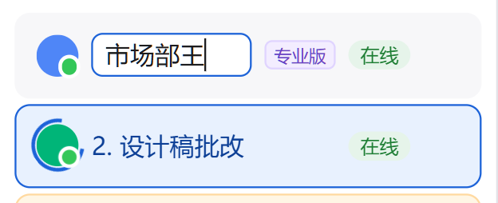
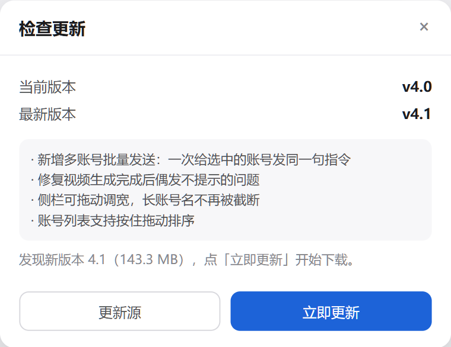
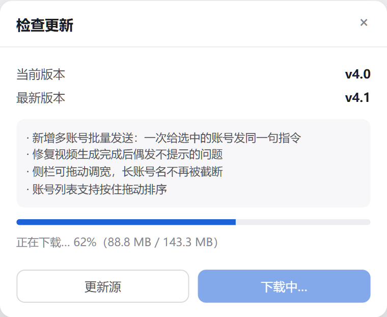

# 豆包多开管理器

  

> 本分支为**测试版v4.2**：在 v4.2 基础上加了后台下载与弹窗防误关，尚未正式发布。

**一个窗口，管住所有豆包账号。**

每个账号都有自己的独立会话和一条常驻页面，切号只是把页面显示出来 ——
**毫秒级、不重载、不丢对话**，所有账号始终在线。

> 本项目基于 [niulaizhineng/doubao-multi-open](https://github.com/niulaizhineng/doubao-multi-open)（MIT）**修改优化**，
> 原作者：[牛来智能](https://github.com/niulaizhineng)。原版版权声明已按 MIT 要求保留在 [LICENSE](LICENSE) 中。



<sub>截图中的账号名称为演示数据</sub>

## 为什么需要它

浏览器开多个豆包标签页行不通 —— 同一浏览器共用 Cookie，第二个标签会把第一个顶掉。
换浏览器或无痕窗口能绕开，但切窗口麻烦、关掉就丢状态。

| 做法 | 多账号同时在线 | 切号成本 | 状态保持 |
|---|---|---|---|
| 同一浏览器多标签 | ✗ 互相顶掉登录态 | —— | —— |
| 多个浏览器 / 无痕窗口 | ✓ | 找窗口、切窗口 | 窗口一关就没了 |
| **本工具** | ✓ | 点一下侧栏（毫秒级） | 页面常驻，不重载 |

## 功能

### 多账号同屏，状态一眼看清



侧栏一列账号，每个名字后面就是它此刻的状态：

- **在线 / 待登录 / 掉线** —— 头像上的小圆点同步变色
- **套餐标识** —— 名字旁显示套餐名，鼠标悬停查看到期时间
- **新回复** —— 你在 A 账号发完指令切去 B，A 跑完会在这里亮起并弹提示
- **生成中** —— 视频这类长任务在后台跑时，头像外圈转蓝色进度环
- **当前账号** —— 蓝底描边，切走再切回，对话原样还在

点「⟳ 检测账号状态」可以全量刷新；点某个账号的状态徽标可单独检测它。

### 双击就地改名



双击账号名直接变成输入框，`Enter` 保存、`Esc` 取消，不用弹窗。
登录后会自动读取官方用户接口的昵称填进去，但**只改默认名，不会覆盖你手动改过的名字**。

### 添加账号 = 直接在右侧扫码

点「＋ 添加账号」，右侧立刻开出一个独立的豆包页面，扫码或验证码登录后自动转正成正式账号，
不用跳转、不用复制 Cookie。

### 检查更新，一键升级

 

点侧栏顶部的版本号（或菜单「帮助 → 检查更新」，快捷键 `Ctrl+U`）：比对版本 → 显示更新说明与体积 →
下载带实时进度 → 下完点「重启并更新」，软件自己关掉、自己重开，已经是新版。

**后台下载**：下载更新包期间可以把弹窗关掉继续干活 —— 进度转到侧栏版本号徽标上
（`下载中 42%`），下完徽标变红显示「可更新」并弹一条提示，点它重新打开弹窗直接就是「重启并更新」。

**弹窗只认关闭按钮**：更新、设置两个弹窗都只能点右上角 × 关闭；点弹窗外面、按 Esc 都不会误关，
正在跑的下载进度不会被一次误点弄丢。

**增量更新**：从 v4.1 起只下载**核心包（约 470 KB）**，只替换 `resources\app\` 里的程序文件，
不碰 Electron 运行时。一次升级几秒钟、几百 KB，而不是 140 MB。

**账号数据完全不碰**：`userdata\`（登录态）、`downloads\`、`profiles\` 明确跳过 ——
升级完不用重新扫码，生成的视频图片也都还在。详见 [自动更新](#自动更新)。

### 其他

- **一键切号**：侧栏点击 / 托盘菜单 / `Ctrl+1~9`
- **视频生成后台等待**：视频任务转入后台持续跟进，真正生成完成才提示，不会提前报「已完成」
- **下载自动归类**：生成的视频图片存到可自定义的下载目录（默认 `downloads\`），落地即弹提示
- **下载提示在侧栏**：完成提示显示在左侧栏底部，不会被右侧账号页面盖住
- **下载位置可设置**：菜单「设置」（`Ctrl+,`）里指定保存目录，所有账号的下载直接存进去，不再建子文件夹
- **托盘常驻**：关闭按钮默认最小化到托盘，托盘右键可切号
- **稳定性**：渲染进程崩溃自动重建视图、页面加载失败自动重试、单实例锁、记住窗口位置、内置 GPU 沙箱兼容参数

## 快捷键

| 快捷键 | 功能 |
|---|---|
| `Ctrl+N` | 添加账号 |
| `Ctrl+1~9` | 切换到第 N 个账号 |
| `Ctrl+R` | 重新加载当前页 |
| `Ctrl+= / Ctrl+- / Ctrl+0` | 页面放大 / 缩小 / 实际大小 |
| `Ctrl+Shift+Q` | 退出程序 |

## 下载即用

不想装环境，直接去 [Releases](../../releases) 下载 **`DoubaoMultiOpen-vX.X-windows-portable.zip`**，
解压到任意目录（**别放 `C:\Program Files`**），双击文件夹里的 `启动豆包多开.bat` 就能用。

> **怎么认对文件**：能跑的包约 **143 MB**，里面是 `DoubaoMultiOpen.exe` + `resources\`。
> Release 页最下面的 `Source code (zip)` 只有 200 KB 左右，那是 GitHub 自动生成的源码包，
> **没有 exe，双击跑不起来**。

- **无需安装 Node.js**，无需联网装依赖，Electron 运行时已内置
- 数据全在程序目录下（`userdata\`），整个文件夹可以随意搬迁、备份
- 体积基本都来自 Electron 运行时（Chromium + Node），程序代码本身只有 60 KB 左右
- 换电脑后需重新扫码登录：登录态用本机密钥加密，拷过去解不开（账号列表和套餐信息会保留）
- 浏览器提示「检测到病毒」是误报（未签名程序 + 新发布无信誉），下载列表里点「保留」即可

只想用的话到这里就够了，下面是原理和开发者内容。

## 原理

- Electron 单窗口 + `WebContentsView` 常驻视图池：每个账号一条视图，切号只改显示与位置
- 每个账号绑定一个 `persist:<id>` 分区会话 → Cookie、LocalStorage、缓存完全隔离
- 不修改豆包官方任何文件；页面直接加载 `www.doubao.com`，官方改版自动兼容

## 从源码运行

1. 安装 [Node.js](https://nodejs.org) ≥ 18
2. 双击 `启动豆包多开.bat`（首次会自动 `npm install`，已配国内镜像）
3. 或手动 `npm install && npm start`

> 依赖装在项目内 `node_modules\`，npm 缓存位置可用 `npm_config_cache` / `ELECTRON_CACHE` 自定义，做到 C 盘零占用。

<details>
<summary>首次运行报 <code>Windows cannot find ...electron.exe</code></summary>

`npm install` 在 `node_modules\electron` 已存在时会报 `up to date` 并跳过 postinstall，
导致 `dist\` 为空、`electron.exe` 补不上。启动脚本已内置兜底：检测到缺失会自动补跑 `node install.js`。
仍失败就手动执行：

```bash
cd node_modules/electron && node install.js
```
</details>

## 自动更新

侧栏顶部的版本号徽标就是入口（菜单「帮助 → 检查更新」，快捷键 `Ctrl+U` 同效）。

- **默认更新源**：本仓库的 GitHub Releases（`releases/latest`）。版本号取 Release 的 tag，
  更新说明取 Release 正文（会自动去掉 Markdown 记号，只显示「本次更新」小节）
- **挑哪个包**：Release 里同时挂 `*-core.zip`（核心包，几百 KB）和 `*-windows-portable.zip`（完整包，143 MB）。
  客户端优先挑 `core`，只覆盖 `resources\app\`；找不到核心包才退回完整包
- **自定义更新源**：弹窗左下「更新源」填自己的地址（留空恢复默认），格式：

```json
{
  "version": "4.1",
  "notes": "- 本次更新内容\n- 第二条",
  "core": {
    "url": "https://你的域名/app-4.1-core.zip",
    "size": 485732,
    "sha256": "可选，填了就校验，不匹配会中止"
  },
  "url": "https://你的域名/app-4.1-full.zip"
}
```

  有 `core` 就走增量，没有就下 `url` 走完整覆盖。

- **核心包长什么样**：内部固定是 `resources\app\main.js …` 这一层结构 ——
  新版据此下钻到 `resources\app` 覆盖；而 v4.0 及更早的客户端只会把整包铺到安装根目录，
  也正好落到同一位置，所以老用户升级同样只要几百 KB
- **替换规则**：核心包只覆盖 `resources\app\`；完整包才覆盖整个安装目录，
  且 `userdata\`、`downloads\`、`profiles\`、`node_modules\` 一律跳过
- **失败排查**：安装目录下的 `update.log` 记了脚本每一步（含 `mode=core` / `robocopy exit=`）

> 从源码目录（`npm start`）跑的时候不要点自动更新 —— 目标目录就是源码目录，
> 完整包会把 exe 和一堆 DLL 铺进去。只有便携版适合走自动更新。

### 发布新版本（维护者）

一条命令完成「改版本号 → 构建便携版 → 打包 → 推源码 → 建 Release → 上传资产 → 校验」：

```bat
set GH_TOKEN=ghp_xxx
node _release\release.js 4.1
```

首次执行会生成 `_release\notes\v4.1.md`，填好更新说明后重跑即可。
加 `--dry-run` 只做本地构建和打包、不上传；`--skip-build` 复用上次构建产物。

> **tag 必须与版本号一致**（脚本已保证）；版本号必须递增，客户端只认「远端 > 本地」；
> 比较只看前三段数字，`v` 前缀会被忽略。

## 目录结构

```
doubao-multi-open\
├─ main.js               主进程(视图池/会话隔离/托盘/IPC/状态检测/自动更新)
├─ preload.js            IPC 安全桥(主窗口)
├─ member-preload.js     注入豆包页面的桥(读昵称/套餐等官方接口)
├─ index.html            侧栏界面
├─ renderer.js           界面逻辑
├─ package.json          依赖声明(electron)
├─ 启动豆包多开.bat      Windows 启动入口(缺依赖时自动安装)
├─ 启动豆包多开.ps1      PowerShell 启动入口
├─ app.ico               应用图标
├─ docs\                 界面截图与配图
└─ README.md             本文件
```

运行时生成（已被 `.gitignore` 排除）：

```
├─ userdata\      各账号分区会话(含登录态,勿外传)
├─ downloads\     生成的视频图片落盘处
└─ *.log          运行日志、更新日志
```

## 风险须知

工具使用 Chromium 分区会话隔离各账号，行为等同「多人共用一台电脑的浏览器」，
正常使用风险很低；但**没有任何方案能保证官方不可检测多账号**。
请勿用于批量注册、自动化群控等违反官方协议的行为。

## 致谢与许可

架构与主体代码来自 [niulaizhineng/doubao-multi-open](https://github.com/niulaizhineng/doubao-multi-open)，
原作者 **牛来智能**，MIT 许可。在此基础上的修改优化包括：

- 新增套餐识别、跨账号完成提醒、视频生成后台等待
- 新增自动更新（检查版本 → 下载 → 重启就地替换，保留账号数据）
- 重做在线状态检测（强凭证 Cookie + 手动全量刷新 + 单账号检测）
- 移除原版的赞赏/收款码模块
- 内置 GPU 沙箱兼容参数，提供便携版与一键发版脚本

原版版权声明按 MIT 许可要求原样保留，见 [LICENSE](LICENSE)：

```
Copyright (c) 2026 牛来智能 (niulaizhineng)
```

本项目同样以 [MIT](LICENSE) 许可发布。
